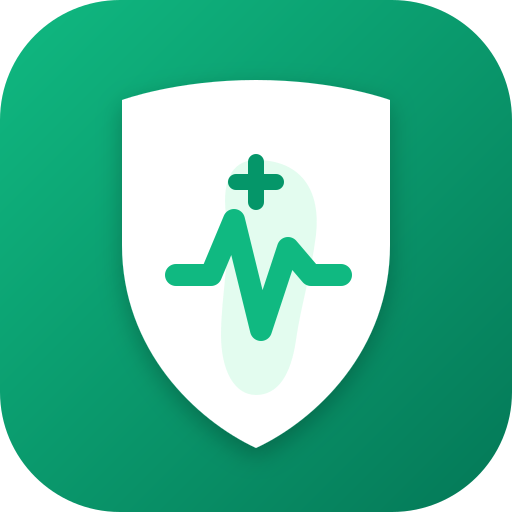

<div align="center">

  

  # 🩺 KakiSehat

  **Aplikasi Progressive Web App (PWA) untuk Deteksi & Self-Check Visual Bengkak Kaki (Edema)**

  [](https://vitejs.dev/)
  [](https://react.dev/)
  [](https://tailwindcss.com/)
  [](https://web.dev/progressive-web-apps/)
  [](https://dexie.org/)
  [](LICENSE)

</div>

---

## 📌 Tentang KakiSehat

**KakiSehat** adalah aplikasi web progresif (PWA) yang dirancang untuk membantu konsumen umum melakukan *self-check* visual mandiri terhadap pembengkakan kaki (edema). Dengan memanfaatkan kamera perangkat, KakiSehat memandu pengguna untuk mengambil foto kaki kiri dan kanan dari sudut yang konsisten, melakukan analisis metrik simetri, selisih ukuran relatif, serta perkiraan warna kulit, dan memberikan rekomendasi awal yang mudah dipahami.

> ⚠️ **Pernyataan Medis (Disclaimer):**
> KakiSehat ditujukan sebagai alat bantu *self-check* dan pemantauan mandiri. Hasil analisis **bukan** diagnosis medis profesional. Jika Anda mengalami pembengkakan yang parah, nyeri hebat, atau bengkak yang tak kunjung surut, segera konsultasikan ke dokter atau fasilitas kesehatan terdekat.

---

## ✨ Fitur Utama

- 📖 **Panduan Foto Interaktif (`/guide`)**: Petunjuk lengkap mengenai pencahayaan, posisi berdiri, dan sudut pengambilan foto (top-down) agar analisis akurat.
- 📸 **Kamera Deteksi Dual-Foot (`/camera`)**:
  - Tangkap foto kaki kiri dan kanan secara berurutan dengan panduan bingkai visual.
  - Fitur pengalih kamera depan/belakang dan pratinjau ulang foto (*retake*) sebelum dikonfirmasi.
  - Manajemen *stream* kamera yang efisien dengan pembersihan (*cleanup*) otomatis.
- 📊 **Analisis Metrik Visual (`/result`)**:
  - **Selisih Ukuran**: Membandingkan estimasi dimensi area kaki kiri dan kanan.
  - **Indikator Warna Kulit**: Deteksi warna permukaan kulit untuk indikasi kemerahan/inflamasi.
  - **Tingkat Simetri**: Persentase kesepadanan bentuk antara kedua kaki.
- 🚦 **Kategori Risiko & Rekomendasi**:
  - **Risiko Rendah (Low)**: Kondisi normal/ringan, diberikan tips perawatan harian.
  - **Risiko Sedang (Medium)**: Indikasi bengkak ringan, saran istirahat dan penanganan awal.
  - **Risiko Tinggi (High)**: Indikasi bengkak signifikan, anjuran untuk rujukan medis.
- 💾 **Penyimpanan Lokal & Offline (Dexie / IndexedDB)**:
  - Riwayat deteksi disimpan secara aman langsung di *browser* perangkat pengguna.
  - Dapat diakses tanpa koneksi internet (PWA offline first).
- 📱 **Progressive Web App (PWA)**:
  - Dapat di-install langsung ke Layar Utama (*Home Screen*) perangkat Android, iOS, maupun Desktop.
  - Dilengkapi ikon PWA adaptif berbagai ukuran (`192x192`, `512x512`, `apple-touch-icon`).

---

## 🎨 Ikon Aplikasi (Generated Brand Assets)

Ikon **KakiSehat** dirancang khusus menggunakan kombinasi simbol perisai medis (*medical shield*), jejak kaki (*footprint*), dan grafik detak kesehatan (*pulse line*) dalam skema warna *emerald green*:

| Asset | Path | Deskripsi |
| :--- | :--- | :--- |
| **Favicon SVG** | `public/favicon.svg` | Vector brand icon untuk tab browser |
| **Logo SVG** | `public/logo.svg` | High-res vector logo untuk dokumentasi & UI |
| **PWA 192x192** | `public/pwa-192x192.png` | PNG icon untuk PWA launcher Android |
| **PWA 512x512** | `public/pwa-512x512.png` | High-density PNG icon untuk splash screen |
| **Apple Touch Icon**| `public/apple-touch-icon.png` | Ikon khusus iOS Home Screen (180x180) |

---

## 🛠️ Teknologi yang Digunakan

- **Framework**: [React 19](https://react.dev/)
- **Routing**: [React Router v7](https://reactrouter.com/)
- **Build Tool & Server**: [Vite 8](https://vitejs.dev/) + [@tailwindcss/vite](https://tailwindcss.com/docs/vite)
- **Styling**: [Tailwind CSS v4](https://tailwindcss.com/)
- **Icon Library**: [Lucide React](https://lucide.dev/)
- **Database Client**: [Dexie.js](https://dexie.org/) (Wrapper IndexedDB)
- **PWA Integration**: [vite-plugin-pwa](https://vite-plugin-pwa.netlify.app/)
- **Asset Processing**: [Sharp](https://sharp.pixelplumbing.com/) (Icon Generator)
- **Runtime**: [Bun](https://bun.sh/) / Node.js

---

## 📁 Struktur Direktori Proyek

```text
kaki-sehat/
├── public/                     # Asset statis PWA & Ikon
│   ├── favicon.svg             # Favicon vektor
│   ├── logo.svg                # Logo utama KakiSehat
│   ├── pwa-192x192.png         # Ikon PWA Android (192px)
│   ├── pwa-512x512.png         # Ikon PWA Splash (512px)
│   └── apple-touch-icon.png    # Ikon iOS Home Screen
├── scripts/
│   └── generate-icons.js       # Script otomatis pembentuk PNG dari SVG dengan Sharp
├── src/
│   ├── components/             # Komponen UI modular
│   │   ├── MetricCard.jsx      # Kartu indikator metrik (Ukuran, Warna, Simetri)
│   │   └── RiskBadge.jsx       # Lencana tingkat risiko (Rendah, Sedang, Tinggi)
│   ├── pages/                  # Halaman aplikasi
│   │   ├── Home.jsx            # Beranda utama & ringkasan hasil terakhir
│   │   ├── Guide.jsx           # Panduan pengambilan foto kaki
│   │   ├── Camera.jsx          # Alur kamera pemandu & konfirmasi foto
│   │   ├── Result.jsx          # Hasil analisis & simpan ke riwayat
│   │   └── History.jsx         # Daftar riwayat deteksi tersimpan
│   ├── App.jsx                 # Layout utama & Bottom Navigation Router
│   ├── db.js                   # Inisialisasi skema Dexie IndexedDB
│   ├── index.css               # Styling global & tema Tailwind CSS v4
│   └── main.jsx                # Entry point React DOM
├── index.html                  # HTML template dengan PWA meta tags
├── package.json                # Dependensi & script proyek
├── tsconfig.json               # Konfigurasi TypeScript / JS compiler
└── vite.config.js              # Konfigurasi Vite, Tailwind, & Plugin PWA
```

---

## 🚀 Panduan Instalasi & Memulai Proyek

### Prasyarat
Pastikan Anda telah menginstal **Bun** (direkomendasikan) atau **Node.js** (v18+):
- [Instal Bun](https://bun.sh/) atau [Instal Node.js](https://nodejs.org/)

### 1. Clone Repository & Install Dependensi
```bash
# Clone repositori
git clone https://github.com/user/kaki-sehat.git
cd kaki-sehat

# Install dependensi menggunakan Bun
bun install
```

### 2. Jalankan Mode Pengembang (Development)
```bash
bun run dev
```
Buka browser dan akses `http://localhost:5173`.

### 3. Generate Asset Ikon (Opsional)
Jika Anda mengubah desain `logo.svg`, Anda dapat meregenerasi seluruh ukuran PNG PWA secara otomatis:
```bash
bun scripts/generate-icons.js
```

### 4. Build untuk Production
```bash
bun run build
```
Hasil build production yang dioptimasi beserta PWA Service Worker (`sw.js`) akan dibuat di folder `dist/`.

### 5. Preview Hasil Build
```bash
bun run preview
```

---

## 📱 Panduan Alur Penggunaan Aplikasi

1. **Beranda (`/`)**:
   - Melihat ringkasan kesehatan kaki dari hasil deteksi terakhir.
   - Tekan tombol **"Mulai Deteksi Kaki"** untuk melakukan pemeriksaan baru.
2. **Panduan Foto (`/guide`)**:
   - Membaca 4 langkah penting pencahayaan dan sudut foto.
   - Klik **"Saya Siap, Mulai Kamera"**.
3. **Kamera Deteksi (`/camera`)**:
   - Posisikan kaki kiri pada area garis bantu, lalu tekan tombol shutter.
   - Tinjau pratinjau foto: pilih **"Ulangi"** atau **"Gunakan Foto"**.
   - Lakukan hal yang sama untuk kaki kanan.
4. **Hasil Analisis (`/result`)**:
   - Sistem menampilkan pratinjau kedua foto kaki, tingkat risiko, persentase simetri, serta rekomendasi tindakan.
   - Tekan **"Simpan Hasil"** untuk menyimpan data secara lokal ke riwayat.
5. **Riwayat (`/history`)**:
   - Menampilkan catatan kronologis pemeriksaan sebelumnya beserta opsi untuk menghapus catatan.

---

## 📄 Lisensi

Proyek ini dilisensikan di bawah [MIT License](LICENSE).

---

<div align="center">
  <p>Dibuat dengan ❤️ untuk mendukung pemantauan kesehatan mandiri yang mudah dan dapat diakses siapa saja.</p>
</div>
